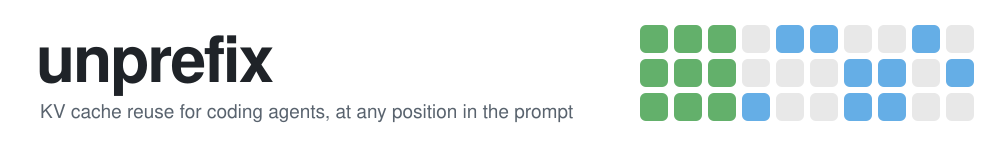
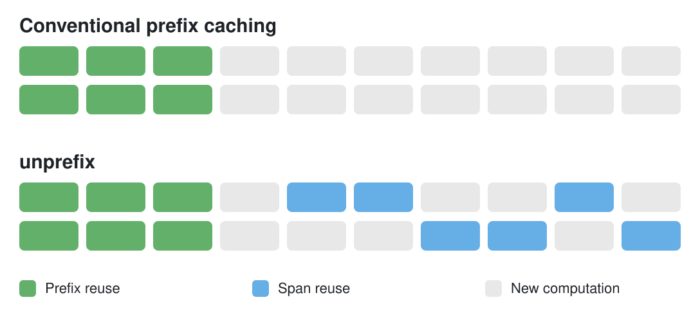
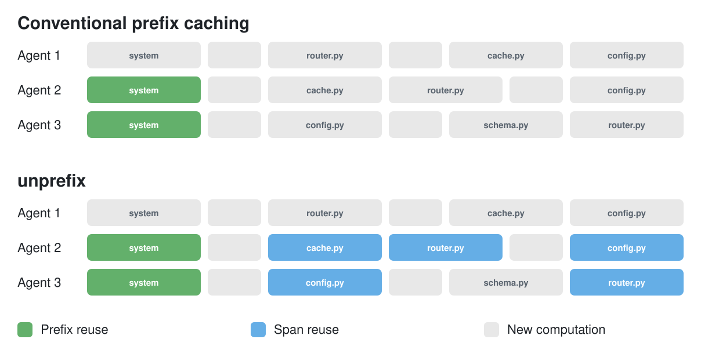

<p align="center">
  
</p>

unprefix runs a local vLLM that caches the KV of the parts of a local Git
repository an agent reads, and reuses them at any position in later prompts
(position-independent caching, PIC). Conventional prefix caching stops at the
first token that differs, so a file read after a different task message is
prefilled again. With unprefix, a file slice that shows up again in a different
order or after a different prefix is not prefilled again; only a small set of
blocks per span is recomputed to repair cross-span attention.

Nothing is cached ahead of time. A tool output becomes a span only when it is a
slice of a file tracked in the repo, and its KV is stored the first time an
agent reads it.

<p align="center">
  
</p>

## Multi-agent workloads

Different agents working on the same repository read the same files, but each
one has its own system prompt and task. Prefix caching reuses each agent's
system prompt from its own earlier turns and nothing across agents. unprefix
also shares every file one agent has already read with all the others, in
whatever order they read it.

<p align="center">
  
</p>

<sub>Block counts in the figures are illustrative, not measurements.</sub>

## How it works

The engine changes live in `patches/vllm-pic.patch`. They touch the scheduler, the
KV-cache manager, the Triton attention backend, RoPE handling and the model runner,
so they cannot be shipped as a vLLM plugin.

## Pinned versions

| | |
|---|---|
| Upstream vLLM | [`a7fdfeef72323eb3db6f0620e4ea200290d0ca5a`](https://github.com/vllm-project/vllm/commit/a7fdfeef72323eb3db6f0620e4ea200290d0ca5a) (between v0.23.0 and v0.24.0rc1) |
| Patch source | development fork, branch `feature/spanshift` at `d063708018` |

The patch only applies to that commit. Other vLLM versions are untested.

## Install

Needs a CUDA machine, `git` and [`uv`](https://docs.astral.sh/uv/), inside an
activated virtualenv.

```bash
git clone https://github.com/unprefix-project/unprefix.git
cd unprefix
./scripts/install-vllm.sh
```

This clones vLLM into `build/vllm`, applies the patch, installs it in editable
mode with the prebuilt upstream kernels, and installs the `unprefix` command.

## Run

Start the patched vLLM:

```bash
VLLM_V1_SPANS_ENABLED=True \
VLLM_V1_SPANS_SPANFUSE_ENABLE=True \
VLLM_USE_V2_MODEL_RUNNER=0 \
vllm serve <model> --attention-backend TRITON_ATTN --block-size 16 \
  --enable-prefix-caching --no-async-scheduling \
  --enable-auto-tool-choice --tool-call-parser <parser>
```

Then put the proxy in front of it and point the agent's OpenAI base URL at
`http://127.0.0.1:8100/v1`:

```bash
unprefix serve --repo /path/to/project --vllm-url http://localhost:8000
```

For each `/v1/chat/completions` request, the proxy renders the chat template,
marks every tool output that is a slice of a tracked file as a span (line-number
prefixes such as `cat -n` output are ignored when matching), pads spans to block
boundaries, and sends the token ids to `/v1/completions` with `span_starts` and
`cross_span_starts`. It turns the raw text back into a chat response through the
patch's `/v1/chat/completions/parse`, so the tool-call and reasoning parsers are
the ones configured on `vllm serve`. Other paths pass through unchanged.

Limits: a tool output with extra text around the file slice is not a span,
streaming returns the whole answer in one chunk, and only the first choice is
returned.

The PIC path lives in the V1 GPU model runner and the Triton attention backend,
so both are required. Other repair policies are selected with
`--gap-policy-name` (`span_aware`, `qcfuse`, `neighbor_aware`, `spanfuse`).
All knobs are `VLLM_V1_SPANS_*` environment variables, documented in
`build/vllm/vllm/envs.py`. The PIC tests run with
`build/vllm/scripts/run_spans_tests.sh`, and the proxy tests with
`python -m pytest tests`.

## Regenerating the patch

From a clone of the development fork:

```bash
git diff --binary a7fdfeef72323eb3db6f0620e4ea200290d0ca5a <branch> > patches/vllm-pic.patch
```

## License

Apache-2.0, same as vLLM. The patch modifies code from the
[vLLM project](https://github.com/vllm-project/vllm).
